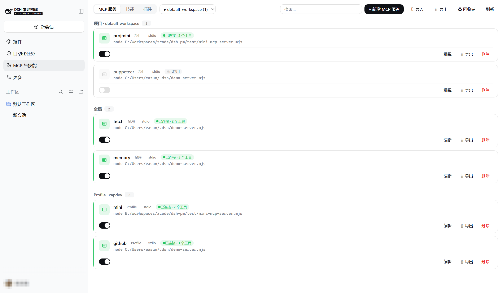
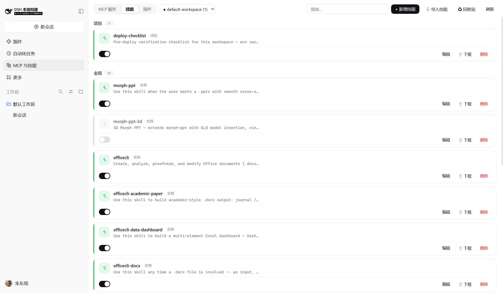
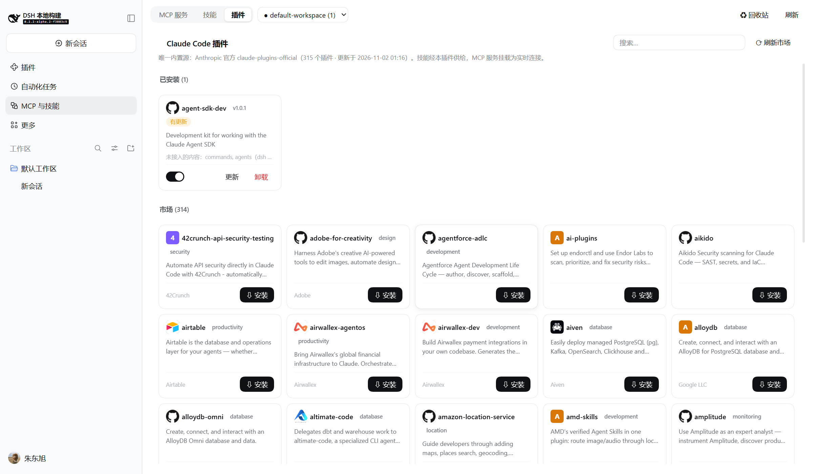
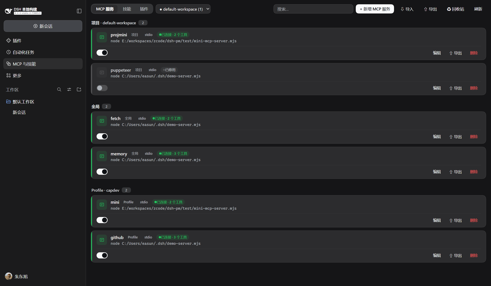

<div align="center">

# dsh-cap-manager

**One panel for MCP servers, skills & Claude Code plugins in the
[DeepSeek Harness](https://github.com/deepseek-ai/deepseek-harness) Web UI.**

[](https://www.npmjs.com/package/dsh-cap-manager)


English | [简体中文](./README.zh.md)

</div>

---

A [DeepSeek Harness](https://github.com/deepseek-ai/deepseek-harness) (dsh) plugin that adds an
**MCP & Skills** panel to the Web UI sidebar:

- **🔌 MCP servers** — cards grouped by scope (**global / profile / project**) with live
  connection status and tool counts. Add, edit, toggle, and delete with immediate effect;
  import `mcpServers` JSON from Claude / Cursor / Cline / Roo / VS Code; export back.
- **🧠 Skills** — every writable skill root (project + user) in one searchable list. Edit
  in place, import `.zip` archives or URLs, one-click export, trash with restore, and
  `.cap-bak` backup history.
- **🧩 Claude Code plugins** — browse Anthropic's official `claude-plugins-official`
  marketplace (315+ plugins) inside dsh: install, update, uninstall, and toggle. Plugin
  skills light up through a native skill provider; plugin `mcpServers` mount as live
  MCP connections.

Full design & compatibility notes: [DESIGN.md](./DESIGN.md). Current release: **v1.1.1**
(adds the Claude Code plugin source).

## 🖼️ Screenshots

The panel appears in the sidebar as **MCP & Skills**. Below: the MCP tab showing all three
scopes — project servers, global servers, and profile servers, each card with live status,
tool count, and an enable switch (a disabled row keeps its config but does not mount).

<div align="center">

</div>

<table>
<tr>
<td width="50%"></td>
<td width="50%"></td>
</tr>
<tr>
<td align="center"><sub>Skills tab — project / global groups plus a read-only plugin-provided group</sub></td>
<td align="center"><sub>Plugins tab — installed cards + the official market (315+)</sub></td>
</tr>
</table>

<div align="center">

<p><sub>Dark mode follows the host theme automatically</sub></p>
</div>

## 📦 Install

**Prerequisite:** [DeepSeek Harness](https://github.com/deepseek-ai/deepseek-harness) ≥
`0.2.1-rc.2` (`dsh` installed globally, or run everything through `npx -y @deepseek-ai/dsh`).

**No build needed** — install straight from the GitHub Release tarball:

```sh
# Web UI
dsh plugin --profile web add https://github.com/easun-zhu/dsh-cap-manager/releases/download/v1.1.1/dsh-cap-manager-1.1.1.tgz
# Desktop client
dsh plugin --profile desktop add https://github.com/easun-zhu/dsh-cap-manager/releases/download/v1.1.1/dsh-cap-manager-1.1.1.tgz
```

Replace `web` / `desktop` with your own profile name, restart dsh, then open
**MCP & Skills** in the left sidebar.

Once the package is on npm:

```sh
dsh plugin --profile web add dsh-cap-manager
```

> If pnpm's release cooldown resolves an older release, pin the version explicitly:
> `dsh plugin --profile web add dsh-cap-manager@1.1.1`.
> (The `github:` git shorthand builds from source — the repository ships no compiled `lib/`;
> prefer the Release tarball or npm.)

From a local checkout:

```sh
pnpm install && pnpm build      # produces lib/index.js + lib/client.js
dsh plugin --profile web add /absolute/path/to/dsh-cap-manager
dsh --profile web               # restart to load the plugin
```

### Optional: install through the plugin market

Host [market/index.json](./market/index.json) anywhere http(s) reachable (GitHub Pages, a raw
GitHub URL, your own server), then add the URL to the dsh **Discover** page (or the
`plugin-market` `indexes` setting). The index pins `engines.dsh >= 0.2.1-rc.2` and installs
from npm. Validate it any time with the upstream validator:

```sh
node --experimental-strip-types test/m5-smoke.ts   # includes market/index.json validation
```

## 🔌 MCP servers

Each project may carry a `.dsh/mcp.yml` (hand-edited or managed from the panel):

```yaml
mcpServers:
  projmini:
    enabled: true               # false = keep config, don't mount
    transport: stdio
    command: node
    args: [./scripts/mcp.mjs]
    env:
      TOKEN: !!js process.env.MY_TOKEN   # evaluated at mount time
```

- The file is the only source of truth: while the project has a live session (or is selected
  in the panel's project picker), its enabled servers are mounted; external edits are picked
  up live (watcher + diff mount).
- `serverName` must stay unique across **all** layers — conflicts are rejected before mount.
- **URL import** (⇩): fetch an `mcpServers` JSON document or a skill `.zip` directly by URL.
  The browser does the fetching, so the target must send CORS headers (GitHub raw and most
  static hosts do); the payload then flows through the exact same preview / unpack pipeline
  as pasted text or local files.
- The add form ships a template dropdown (filesystem, memory, sequential-thinking, fetch,
  github, puppeteer) for one-click starter configs.

## 🔁 Import / export

- **Import** (MCP tab → ⇩): paste, upload, or fetch an `mcpServers` JSON document — VS Code's
  JSONC dialect (comments, trailing commas) is tolerated, `sse` entries map to
  `streamable-http` with a warning, invalid keys are auto-slugged and flagged. `${VAR}` /
  `${env:VAR}` references become `!!js process.env.VAR` expressions (backtick templates when
  embedded); VS Code `${input:…}` placeholders render a credential form whose values are
  substituted at apply time. Preview lists every conversion, rename, and failure; applying
  reuses the normal write path (shared validation, HMR live effect).
- **Export** (MCP tab → ⇧): merges every managed row plus the selected project's file into a
  standard `{"mcpServers": …}` document; `!!js` expressions fold back to `${VAR}`. Disabled
  rows are skipped (the format has no disabled flag). Secrets are exported in clear text —
  the UI says so.
- **Skills import** (Skills tab → ⇩): a `.zip` archive (an extra wrapper directory is fine —
  skill roots are discovered by `SKILL.md` location), a folder, loose `.md` files, or a zip
  URL; archives up to 10 MB / 200 files, zip-slip paths rejected, macOS junk dropped. Files
  land verbatim; same-name skills are skipped unless overwrite is checked.
- **Skill export** (⇧ on a card): directory skills download as `.zip` (assets included),
  file skills as `.md`.
- **Trash & backups** (♻): deleted skills list with their original path and restore
  one-click; every `.cap-bak-*` copy beside the managed files (patches, project `mcp.yml`,
  SKILL.md — 5 kept per file) can be restored over its target or deleted.

## 🧠 Skills

The Skills tab scans the four writable roots (`<project>/.dsh/skills`,
`<project>/.agents/skills`, `~/.dsh/skills`, `~/.agents/skills`) with the provider's own
rules and resolves same-name duplicates by its rank order (project wins over user);
shadowed entries and unparsable files surface with badges instead of vanishing. Edits write
SKILL.md atomically (unknown frontmatter keys and comments preserved, toggles normalized to
`true/false`); deletion moves the directory into `~/.dsh/cap-manager/trash/` (with
`trash-meta.json` recording the origin) and warns when a shadowed twin surfaces.

## 🧩 Claude Code plugins

The panel's third tab manages Claude Code plugins from Anthropic's official
`claude-plugins-official` marketplace — the only built-in source.

| | |
|---|---|
| **Market** | 315+ plugins, cached 10 min on the host, refresh button forces a refetch, with search |
| **Install** | downloads the pinned GitHub tarball (codeload), unpacks with a strict tar reader (traversal paths rejected, symlinks skipped), stores under `~/.dsh/cap-manager/plugins/store/<name>/<version>/` |
| **Skills** | `skills/*/SKILL.md` served live through a `ctx.skills` provider — they appear in the Skills tab under a read-only plugin group the moment the plugin is enabled (ranked below your own skills, so a same-name user skill wins) |
| **MCP servers** | `mcpServers` from each plugin's manifest mount as live connections — the same converter and diff/mount discipline as project-level servers, including the cross-layer `serverName` precheck; the card shows live status and tool counts |
| **Toggle** | flips skills and MCP servers on/off instantly |
| **Precise updates** | "Refresh market" also fetches the marketplace repo's HEAD commit sha, so every installed plugin — external git sources (entry sha) and in-repo path sources (HEAD sha) — gets an exact "update available" verdict; sha-pinned sources show an update badge. Clicking Update downloads and byte-compares first: identical content only adopts the new pin (no reinstall), changed content reinstalls |
| **Uninstall** | disposes mounts, deletes the store directory, and clears the registry (atomic `registry.json` with `.cap-bak` history) |
| **Timeouts** | all network calls are time-bounded (20 s index / 120 s tarballs); a failed refresh serves the cached index |

Content dsh has no equivalent for (`commands/`, `agents/`, `hooks/`) is kept on disk and
honestly labeled as not wired up on the installed card.

## 🛠️ Development

- `pnpm typecheck` — tsc over `src/`
- `pnpm build` — host half (esbuild ESM, packages external) + client half (esbuild CJS in the
  `window.__ModuleLoader__.load` registration contract, with a build-time contract assertion)
- Smoke tests: `node --experimental-strip-types test/m4-smoke.ts` (converters),
  `test/m5-smoke.ts` (templates + market index), `test/m6-smoke.ts` (tar reader, subtree
  download, manifest conversion)
- Harness packages are `peerDependencies`; at runtime the profile links them to the running
  dsh's copies, so never bundle them.

### From a repo checkout

A `deepseek-harness` source checkout must complete `pnpm run build:artifacts` once before it
can serve the Web client: the boot scans every graph package that declares `dsh.client` and
fails on any missing `lib/client.js`. A checkout that only built server artifacts will hit
`ENOENT .../lib/client.js` on startup.

> ⚠️ **Never point `--from-default-profile` at an existing profile**: it resets the
> profile's `package.json`, patch, and node_modules — wiping plugin installs. Use plain
> `--profile` for boots; `--from-default-profile` is a one-shot initializer only.

## 📁 Project layout

| Path | Role |
|---|---|
| `src/index.ts` | host half entry (mounts CapabilityManagerService) |
| `src/service.ts` | capabilityManager Typert Remote service (patch + project + skills routing) |
| `src/scopes.ts` | adapter: profile patch composition + scope attribution |
| `src/config-view.ts` | raw row config ↔ masked wire view, `!!js` tagging (shared) |
| `src/patch-writer.ts` | comment-preserving edits of cordis.patch.yml layers |
| `src/project-config.ts` | `<project>/.dsh/mcp.yml` parse (incl. `!!js` evaluation) + writes |
| `src/project-mounter.ts` | session-following + watcher + diff mount of project servers |
| `src/skills-store.ts` | skill roots scan, frontmatter read/write, trash (+meta), archive import/bundle |
| `src/import-mcp.ts` | mcpServers JSON → wire config conversion + export inversion |
| `src/cc-market.ts` | claude-plugins-official marketplace cache + safe tar.gz reader |
| `src/cc-store.ts` | plugin registry, skill provider (rank 550), MCP mounts |
| `src/status-tracker.ts` | adapter: fiber states (numeric FiberState) + `mcp__` tool counts |
| `src/client/index.ts` | browser half entry (locale + remote $mount + slots) |
| `src/client/CapabilitiesPage.tsx` | the panel (cards, tabs, search, project picker) |
| `src/client/McpEditor.tsx` | MCP form editor (templates + catalog prefill) |
| `src/client/SkillEditor.tsx` | skill form + markdown body editor |
| `src/client/ImportWizard.tsx` | mcpServers JSON import wizard (paste/file/URL) |
| `src/client/SkillImport.tsx` | zip/folder/.md/URL skill import |
| `src/client/catalog.ts` | template-dropdown starter data |
| `src/client/CcPluginsPanel.tsx` | Claude Code plugin market + installed cards |
| `src/client/TrashPanel.tsx` | trash restore + `.cap-bak` backup browser |
| `src/client/files.ts` | base64/zip codecs (fflate), downloads, URL fetching |
| `market/index.json` | plugin-market format-1 index for the Discover page |
| `test/` | node smoke checks (`m4` converters, `m5` templates + market index, `m6` tar/manifest) |

## 📤 Publishing (maintainers)

1. Replace the `OWNER` placeholder in `package.json` (`repository`, `homepage`) and
   `market/index.json` (`homepage`, `repository.url`) with the real GitHub owner; add a
   `LICENSE` file (the package declares MIT).
2. `pnpm typecheck && pnpm build && node --experimental-strip-types test/m4-smoke.ts &&
   node --experimental-strip-types test/m5-smoke.ts` — all must pass.
3. `npm publish` (the package ships `lib/` + `cordis.patch.yml`; harness packages stay
   peerDependencies).
4. Add the `dsh-plugin` GitHub topic to the repository (community discovery convention, e.g.
   [awesome-deepseek-harness](https://github.com/0xsline/awesome-deepseek-harness) lists by it).
5. Host `market/index.json` (GitHub Pages or a raw URL) and share the URL; bump
   `publishTimestamp` / add a version entry for each release.

## 📄 License

[MIT](./LICENSE) · Full design document: [DESIGN.md](./DESIGN.md).
