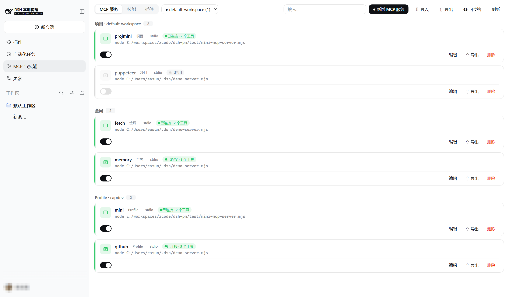
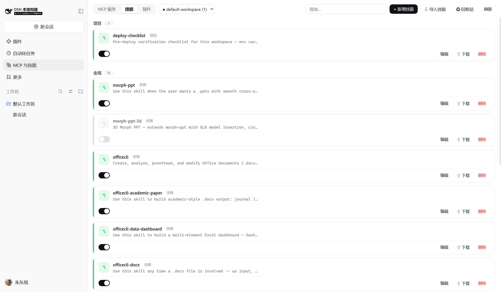
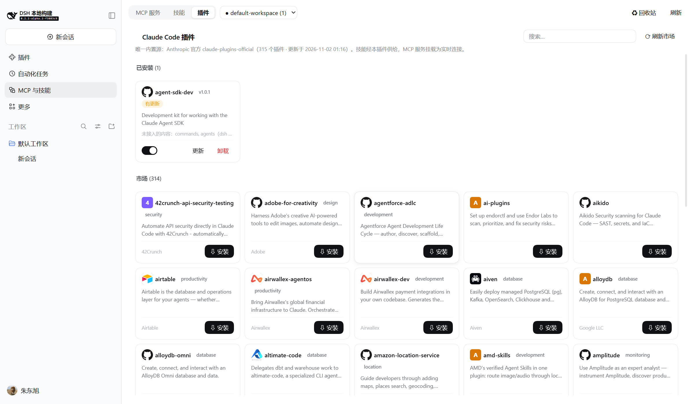
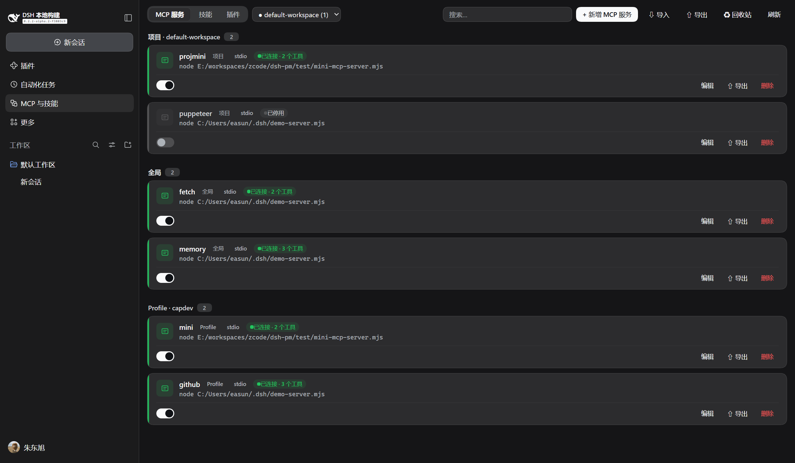

<div align="center">

# dsh-cap-manager

**在 [DeepSeek Harness](https://github.com/deepseek-ai/deepseek-harness) Web UI 中
一个面板统一管理 MCP 服务、技能与 Claude Code 插件。**


[English](./README.md) | **简体中文**

</div>

---

一款 [DeepSeek Harness](https://github.com/deepseek-ai/deepseek-harness)（dsh）插件：在
Web UI 侧边栏增加 **MCP 与技能** 面板：

- **🔌 MCP 服务** —— 按**全局 / Profile / 项目**三作用域分组的卡片，实时显示连接状态
  与工具数。新增、编辑、开关、删除即时生效；支持从 Claude / Cursor / Cline / Roo /
  VS Code 导入 `mcpServers` JSON，也支持导出。
- **🧠 技能** —— 项目与用户全部可写技能根汇成一份可搜索列表。就地编辑、导入
  `.zip` 压缩包或 URL、一键导出、回收站恢复、`.cap-bak` 备份历史。
- **🧩 Claude Code 插件** —— 在 dsh 里浏览 Anthropic 官方 `claude-plugins-official`
  市场（315+ 个插件）：安装、更新、卸载、开关。插件技能经原生 skill provider 实时
  供给；manifest 里的 `mcpServers` 挂载为实时 MCP 连接。

完整设计与兼容性说明见 [DESIGN.md](./DESIGN.md)。当前版本：**v1.1.0**
（新增 Claude Code 插件源）。

## 🖼️ 截图

面板以 **MCP 与技能** 出现在侧边栏。下图是 MCP 页 —— 项目 / 全局 / Profile 三个
作用域分组，每张卡片带实时状态、工具数与启停开关（已停用的行保留配置但不挂载）。

<div align="center">

</div>

<table>
<tr>
<td width="50%"></td>
<td width="50%"></td>
</tr>
<tr>
<td align="center"><sub>技能页 —— 项目 / 全局分组 + 只读插件提供分组</sub></td>
<td align="center"><sub>插件页 —— 已安装卡片 + 官方市场（315+）</sub></td>
</tr>
</table>

<div align="center">

<p><sub>深色模式自动跟随宿主主题</sub></p>
</div>

## 📦 安装

**前置**：[DeepSeek Harness](https://github.com/deepseek-ai/deepseek-harness) ≥
`0.2.1-rc.2`（全局安装 `dsh`，或全部通过 `npx -y @deepseek-ai/dsh` 运行）。

**免编译** —— 直接从 GitHub Release 的 tarball 安装：

```sh
# 浏览器 Web UI
dsh plugin --profile web add https://github.com/easun-zhu/dsh-cap-manager/releases/download/v1.1.0/dsh-cap-manager-1.1.0.tgz
# 桌面客户端
dsh plugin --profile desktop add https://github.com/easun-zhu/dsh-cap-manager/releases/download/v1.1.0/dsh-cap-manager-1.1.0.tgz
```

`web` / `desktop` 换成你自己的 profile 名即可；重启 dsh，然后在左侧边栏打开
**MCP 与技能**。

包发布到 npm 后：

```sh
dsh plugin --profile web add dsh-cap-manager
```

> 若 pnpm 的发布冷却期解析到旧版本，可显式固定版本：
> `dsh plugin --profile web add dsh-cap-manager@1.1.0`。
> （`github:` git 简写等于从源码装 —— 仓库不含编译产物 `lib/`，优先用 Release
> tarball 或 npm。）

从本地目录安装：

```sh
pnpm install && pnpm build      # 产出 lib/index.js + lib/client.js
dsh plugin --profile web add /absolute/path/to/dsh-cap-manager
dsh --profile web               # 重启以加载插件
```

### 可选：通过插件市场安装

把 [market/index.json](./market/index.json) 托管到任意 http(s) 可访问的位置（GitHub
Pages、GitHub raw、自己的服务器），再把 URL 添加到 dsh 的**发现**页（或
`plugin-market` 的 `indexes` 配置）。索引声明了 `engines.dsh >= 0.2.1-rc.2`，安装源
为 npm。可随时用上游校验器验证：

```sh
node --experimental-strip-types test/m5-smoke.ts   # 含 market/index.json 校验
```

## 🔌 MCP 服务

每个项目可携带 `.dsh/mcp.yml`（手改或面板管理）：

```yaml
mcpServers:
  projmini:
    enabled: true               # false = 保留配置，不挂载
    transport: stdio
    command: node
    args: [./scripts/mcp.mjs]
    env:
      TOKEN: !!js process.env.MY_TOKEN   # 挂载期求值
```

- 文件是唯一事实源：项目存在活动会话（或被面板项目选择器选中）时，其 enabled 的
  服务被挂载；外部修改即时生效（watcher + 差异挂载）。
- `serverName` 跨**所有**层唯一 —— 冲突在挂载前即被拒绝。
- **URL 导入**（⇩）：按 URL 直接抓取 `mcpServers` JSON 文档或技能 `.zip`。抓取由
  浏览器执行，目标需发送 CORS 头（GitHub raw 与多数静态托管都支持）；载荷随后进入
  与粘贴文本 / 本地文件完全相同的预览 / 解包管线。
- 新增表单内置模板下拉（filesystem、memory、sequential-thinking、fetch、github、
  puppeteer），一键填充起步配置。

## 🔁 导入与导出

- **导入**（MCP 页 → ⇩）：粘贴、选文件或 URL 抓取 `mcpServers` JSON —— 容忍 VS Code
  的 JSONC 方言（注释、尾逗号），`sse` 条目映射为 `streamable-http` 并警告，非法键
  自动 slug 化并标记。`${VAR}` / `${env:VAR}` 引用转为 `!!js process.env.VAR` 表达式
  （嵌入时为反引号模板）；VS Code 的 `${input:…}` 占位渲染凭据表单，应用时替换。
  预览列出每条转换、改名与失败；应用复用常规写入路径（共享校验、HMR 实时生效）。
- **导出**（MCP 页 → ⇧）：全部受管行 + 选中项目文件合并为标准
  `{"mcpServers": …}` 文档；`!!js` 表达式还原为 `${VAR}`。已停用行跳过（标准格式无
  停用位）。密钥以明文导出 —— UI 明示。
- **技能导入**（技能页 → ⇩）：`.zip`（允许多一层包装目录 —— 按 `SKILL.md` 位置识别
  技能根）、文件夹、散 `.md` 或 zip URL；上限 10 MB / 200 文件，拒绝 zip-slip 路径，
  丢弃 macOS 垃圾文件。文件逐字节原样落盘；同名默认跳过，勾选覆盖才替换。
- **技能导出**（卡片上的 ⇧）：目录技能下载为 `.zip`（含资源），文件技能为 `.md`。
- **回收站与备份**（♻）：已删技能列出原路径并可一键恢复；受管文件旁的每份
  `.cap-bak-*`（patch、项目 `mcp.yml`、SKILL.md —— 每文件保留 5 份）可恢复到目标
  或删除。

## 🧠 技能

技能页扫描四个可写根（`<project>/.dsh/skills`、`<project>/.agents/skills`、
`~/.dsh/skills`、`~/.agents/skills`），按 provider 自身规则处理，同名冲突按 rank
顺序裁决（项目胜过用户）；被遮蔽条目与无法解析的文件以角标显式呈现而不是消失。
编辑原子写 SKILL.md（保留未知 frontmatter 键与注释，开关统一为 `true/false`）；删除
把目录移入 `~/.dsh/cap-manager/trash/`（`trash-meta.json` 记录来源），同名遮蔽浮出时
给出警告。

## 🧩 Claude Code 插件

面板第三个 tab 管理来自 Anthropic 官方 `claude-plugins-official` 市场的 Claude Code
插件 —— 唯一内置源。

| | |
|---|---|
| **市场** | 315+ 个插件，宿主 10 分钟缓存，刷新按钮强制重拉，支持搜索 |
| **安装** | 下载 pin 住的 GitHub tarball（codeload），严格 tar 解包器落盘（逃逸路径拒绝、符号链接跳过），存入 `~/.dsh/cap-manager/plugins/store/<名称>/<版本>/` |
| **技能** | 插件的 `skills/*/SKILL.md` 经 `ctx.skills` provider 实时供给 —— 启用即出现在技能页的只读插件组（rank 排在你自己的技能之后，同名时用户技能优先） |
| **MCP 服务** | manifest 声明的 `mcpServers` 挂载为实时连接 —— 与项目级服务同一套转换与 diff/挂载纪律，含跨层 `serverName` 预检；卡片显示实时状态与工具数 |
| **开关** | 技能 + MCP 一起即时启停 |
| **精确更新** | 点「刷新市场」顺带取 marketplace 仓库的 HEAD commit sha，每个已装插件（外部 git 源比对条目 sha，仓库内源比对 HEAD sha）都得到精确的"有更新"判定；sha-pin 源显示更新角标。点「更新」先下载并**逐字节内容比对**：相同只采纳新 pin 不重装，不同才重装 |
| **卸载** | 卸挂载、删 store 目录、清登记（`registry.json` 原子写 + `.cap-bak` 历史） |
| **超时** | 所有网络调用限时（索引 20 s / tarball 120 s）；刷新失败自动回退缓存 |

dsh 没有对应机制的内容（`commands/`、`agents/`、`hooks/`）保留在磁盘，并在已安装
卡片上如实标注"未接入"。

## 🛠️ 开发

- `pnpm typecheck` —— 对 `src/` 跑 tsc
- `pnpm build` —— 宿主半（esbuild ESM，包全部 external）+ 浏览器半（esbuild CJS，
  `window.__ModuleLoader__.load` 注册契约，构建期断言）
- 冒烟测试：`node --experimental-strip-types test/m4-smoke.ts`（转换器）、
  `test/m5-smoke.ts`（模板 + 市场索引）、`test/m6-smoke.ts`（tar 解包、子树下载、
  manifest 转换）
- harness 各包是 `peerDependencies`；运行期 profile 链接到正在运行的 dsh 的副本，
  绝不打包。

### 从源码检出运行

`deepseek-harness` 源码检出必须先完成一次 `pnpm run build:artifacts` 才能服务 Web
客户端：启动会扫描所有声明 `dsh.client` 的包，缺 `lib/client.js` 即失败。只构建过
服务端产出的检出会在启动时报 `ENOENT .../lib/client.js`。

> ⚠️ **绝不要把 `--from-default-profile` 指向已存在的 profile**：它会重置该
> profile 的 `package.json`、patch 和 node_modules —— 清空已装插件。启动一律用
> `--profile`；`--from-default-profile` 只作一次性初始化。

## 📁 目录结构

| 路径 | 职责 |
|---|---|
| `src/index.ts` | 宿主半入口（挂载 CapabilityManagerService） |
| `src/service.ts` | capabilityManager Typert Remote 服务（patch + 项目 + 技能路由） |
| `src/scopes.ts` | 适配层：profile patch 组合 + 作用域归属 |
| `src/config-view.ts` | 原始行配置 ↔ 脱敏视图，`!!js` 标签化（共用） |
| `src/patch-writer.ts` | 保注释编辑 cordis.patch.yml 各层 |
| `src/project-config.ts` | `<project>/.dsh/mcp.yml` 解析（含 `!!js` 求值）+ 写入 |
| `src/project-mounter.ts` | 会话跟随 + watcher + 差异挂载项目服务 |
| `src/skills-store.ts` | 技能根扫描、frontmatter 读写、回收站（+元数据）、压缩包导入/打包 |
| `src/import-mcp.ts` | mcpServers JSON → wire 配置转换 + 导出反演 |
| `src/cc-market.ts` | claude-plugins-official 目录缓存 + 安全 tar.gz 解包器 |
| `src/cc-store.ts` | 插件 registry、技能 provider（rank 550）、MCP 挂载 |
| `src/status-tracker.ts` | 适配层：fiber 状态（数字 FiberState）+ `mcp__` 工具计数 |
| `src/client/index.ts` | 浏览器半入口（locale + remote $mount + slots） |
| `src/client/CapabilitiesPage.tsx` | 面板（卡片、tab、搜索、项目选择器） |
| `src/client/McpEditor.tsx` | MCP 表单编辑器（模板 + 目录预填） |
| `src/client/SkillEditor.tsx` | 技能表单 + Markdown 正文编辑器 |
| `src/client/ImportWizard.tsx` | mcpServers JSON 导入向导（粘贴/文件/URL） |
| `src/client/SkillImport.tsx` | zip/文件夹/.md/URL 技能导入 |
| `src/client/catalog.ts` | 模板下拉起步数据 |
| `src/client/CcPluginsPanel.tsx` | Claude Code 插件市场 + 已安装卡片 |
| `src/client/TrashPanel.tsx` | 回收站恢复 + `.cap-bak` 备份浏览 |
| `src/client/files.ts` | base64/zip 编解码（fflate）、下载、URL 抓取 |
| `market/index.json` | plugin-market format-1 索引（发现页用） |
| `test/` | node 冒烟检查（`m4` 转换器、`m5` 模板 + 市场索引、`m6` tar/manifest） |

## 📤 发布（维护者）

1. 把 `package.json`（`repository`、`homepage`）与 `market/index.json`（`homepage`、
   `repository.url`）中的 `OWNER` 占位替换为真实 GitHub 用户名；补上 `LICENSE`
   文件（包声明 MIT）。
2. `pnpm typecheck && pnpm build && node --experimental-strip-types test/m4-smoke.ts &&
   node --experimental-strip-types test/m5-smoke.ts` —— 全部通过。
3. `npm publish`（包内容为 `lib/` + `cordis.patch.yml`；harness 各包保持
   peerDependencies）。
4. 给仓库加上 `dsh-plugin` GitHub topic（社区发现惯例，
   [awesome-deepseek-harness](https://github.com/0xsline/awesome-deepseek-harness)
   按此收录）。
5. 托管 `market/index.json`（GitHub Pages 或 raw URL）并分享该 URL；每次发版更新
   `publishTimestamp` / 增加版本条目。

## 📄 许可

[MIT](./LICENSE) · 完整设计文档：[DESIGN.md](./DESIGN.md)。
